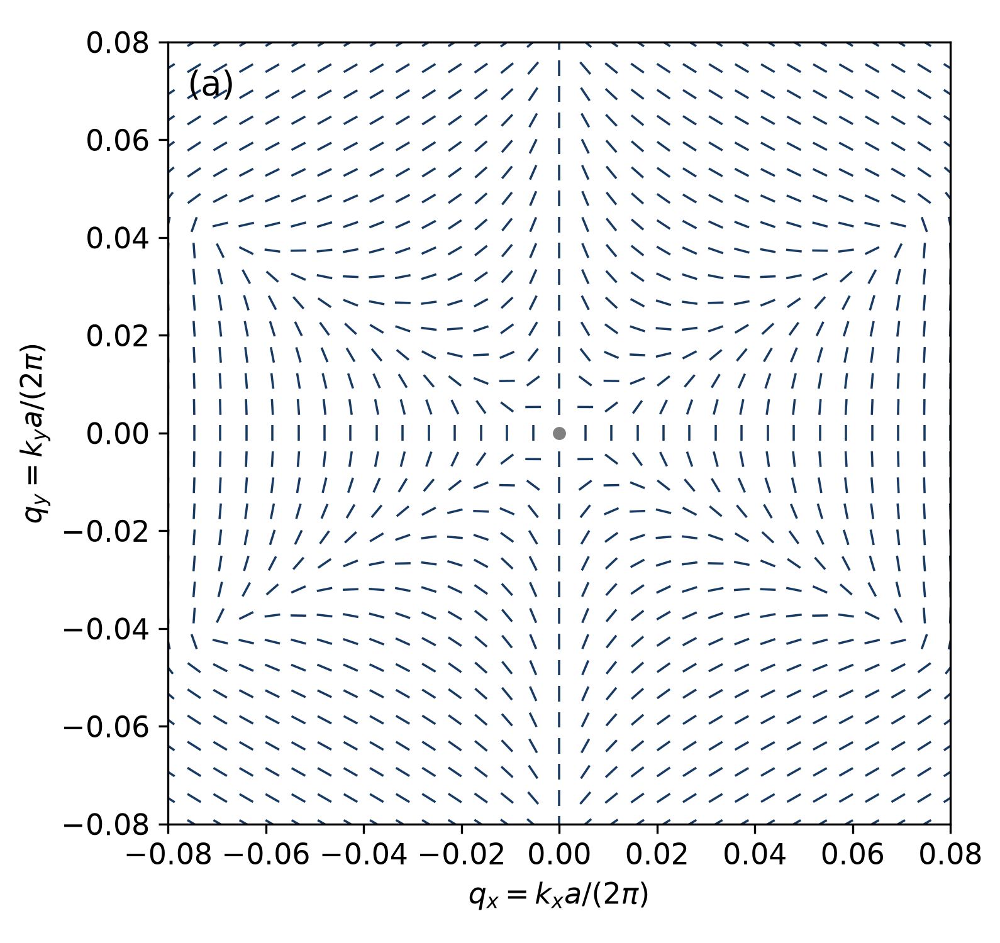

# ACS 2023：mode 2 偏振诊断与完整二维图

本目录归档 90° 偏振差异的单点多模态诊断、12/96 点闭环、mode 2 的完整二维本征模计算、路径一致性检查及短线展示图。原始 Fig. S1 和 PRL 复现结果保留在原目录。

## 推荐查看

- [mode 2 原始偏振短线图](figures/mode2_polarization_shortlines.png)
- [当前模式与 mode 2 的短线对照](figures/current_vs_mode2_shortlines.png)
- [完整诊断报告](reports/ACS_90deg_diagnosis.md)
- [完整 mode 2 数据](data/fullgrid_mode2.csv)
- [数值验证摘要](validation/fullgrid_summary.json)



## 结果与限制

- 默认网格为 **31×31、qx/qy ∈ [−0.08,0.08]**，按用户指定优先范围计算。原始 Fig. S1 复现网格范围为 ±0.15；两者范围不同。
- `gmax=4.5`、`gmode_inds=[0,3]`、`numeig=12`，a=724nm、h=100nm、r=200nm、eps=4，上下空气；传入 Legume 的 k=2πq。
- mode 2 以 q=(0.04,0) 的已诊断本征模为锚，f=0.9349527700、y 镜面奇。Γ 子空间频率为 0.9364949305，与旧模式的 0.8874621514 不同。共有物理基底标签上的归一化本征矢重叠及自适应步长用于追踪，没有按固定序号、Q 或所需偏振方向挑模。
- 960 个非中心点、1,856 条邻边检查通过，路径身份不一致为 0；最小接受重叠 0.971185。Γ 点以简并子空间处理并掩膜偏振角。
- Γ 附近 96 点闭环荷为 **−2**；完整窗口外方形边界用 120/240/480 点验证的总绕转为 **0**。外边界总绕转不能当作 Γ 局部荷。
- 与旧模式的全网格正交误差：中位 **14.892450°**、90% 分位 **41.016291°**、最大 **80.204868°**，误差小于 5° 的比例为 **24.17%**。此前 12 点恰在高对称方向，其正交关系不能外推到全二维。
- 最终仍为 **F：不足以确认论文目标模式身份**。不能把 mode 2 认定为整张旧图的统一 90° 旋转伙伴。仍缺论文目标能带/近场标记及与代码晶格轴的对应。用户提供的参考截图用于短线样式；论文/SI 全文未归档。

短线图仅把线段长度从0.0068改为0.0032；Jones 数据和偏振方向不变。原长线图同时保留，没有人工旋转图或给偏振角加90°。

## 目录

|目录|内容|
|---|---|
|`scripts/`|独立计算、验证和绘图脚本；路径相对于仓库定位|
|`data/`|单点/闭环/二维原始数据、本征矢、近简并子空间及追踪记录|
|`figures/`|12点比较、近场、二维长线/短线图和诊断热图|
|`validation/`|数值摘要、来源与SHA256、原始文件完整性核验、旧名到新路径映射|
|`reports/`|完整诊断记录，保留计算阶段的历史说明|

根目录旧工作稿、`.before_remote_discovery` 备份及临时 Git 状态文件没有混入科学结果归档，仍保留在原本地位置。`validation/filename_mapping.json` 可按原始文件名查找新路径。

## 使用已有结果

以下命令从**仓库根目录**执行，使用 Python 3.12。当前环境可用 `/workspace/.venvs/legume/bin/python` 替代 `python`。

```bash
# 在其他环境中安装（当前实例已安装，无需再次执行）
python -m pip install -e '.[test,autodiff]' -r reproduction_results/ACS_Photonics_2023/mode2_diagnosis/requirements.txt

# 无需重新计算本征模：从归档CSV绘制短线图，并核验完整数据
python reproduction_results/ACS_Photonics_2023/mode2_diagnosis/scripts/plot_shortlines.py
python reproduction_results/ACS_Photonics_2023/mode2_diagnosis/scripts/validate_fullmap.py
```

## 重新计算

这些命令只生成本目录下的数据/图和被忽略的 `.cache/`，不会修改原始 ACS/PRL 脚本或结果。

```bash
# 单点多模态和12点诊断（先运行，建立模式锚表）
python reproduction_results/ACS_Photonics_2023/mode2_diagnosis/scripts/diagnose_modes.py

# mode 2 与旧模式的完整二维计算及1856条边的自适应核验
python reproduction_results/ACS_Photonics_2023/mode2_diagnosis/scripts/compute_mode2_fullmap.py

# 局部65点避交叉路径、外方形边界加密及最终核验
python reproduction_results/ACS_Photonics_2023/mode2_diagnosis/scripts/validate_local_continuity.py
python reproduction_results/ACS_Photonics_2023/mode2_diagnosis/scripts/validate_outer_boundary.py
python reproduction_results/ACS_Photonics_2023/mode2_diagnosis/scripts/validate_fullmap.py
python reproduction_results/ACS_Photonics_2023/mode2_diagnosis/scripts/plot_shortlines.py
```

只复核中心闭环可用 `compute_mode2_fullmap.py --loop-only`。主计算默认约数分钟，缓存是检查点记录，不提供自动续算。`validate_fullmap.py` 针对本目录归档的默认31×31、±0.08配置；改变网格后需相应调整验证目标。

## 数据约定与可追溯性

`fullgrid_mode2.csv` 的实/虚频率单位均为 c/a；THz换算为 f×299792.458/724，波长nm为724/f。Q=f/(2|f_im|)。Ex/Ey是上方G=0、损耗归一化复电场，非SI电场。S2=2Re(Ex*Ey)，S3=2Im(Ex*Ey)，psi为弧度；后缀`_deg`的量为角度制。正交误差按mod180°的主轴距离计算。

`mode_index` 为0-based局部排序。所有非中心点恰好为2是追踪结果；Γ点`mode_index=-1`表示由非零kx极限投影到[2,3]简并子空间，不能解释为单一本征值序号。`polarization_valid=False`时psi写NaN；`reliable`表示追踪/子空间识别通过。

`provenance.json` 记录求解器基线e205b78、软件版本和归档原始文件SHA256。脚本只修改了布局和路径；`requirements.txt`保留当前验证环境的软件版本。对原有能带/远场图及Legume核心源码未作修改。完整二维计算已经在原路径执行成功；整理后再次验证脚本路径、96点闭环、数据一致性及短线绘图，无需为了归档重复完整网格计算。
